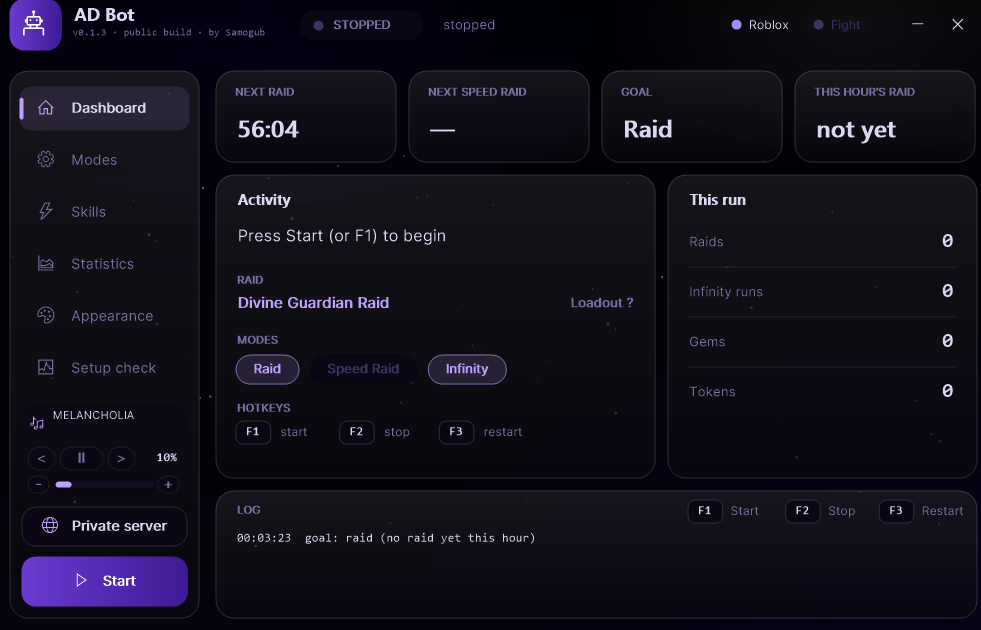
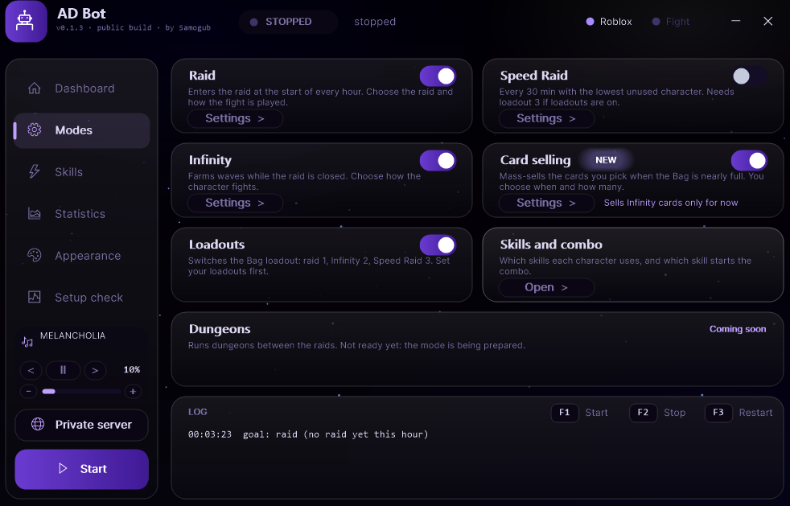

# AD Bot

**Unattended farming bot for Anime Dimensions Simulator (Roblox) that keeps going when Roblox itself fails.**

> Roblox disconnects, hangs on a teleport, loops a retry screen or simply closes? AD Bot was built first of all for players for whom this happens **all the time**. It notices the problem, closes the game, joins again and carries on by itself, so a night run does not end at the first crash.

Version 0.1.5 · Windows · AutoHotkey v2 · by Samogub

---

## Built to survive Roblox failures

The bot checks what is on the screen on every tick. These are the failures it handles, and how:

| What goes wrong | What the bot does |
|---|---|
| **Disconnected** (Error 279, lost connection, Reconnect window) | After about 90 s on a screen it does not recognise, it reads the centre of the screen with OCR. If it sees the disconnect text, it closes Roblox and joins again. Usually the game is back within a few minutes. |
| **Roblox window is gone** (crash, closed) | After 60 s without a Roblox window it relaunches the game. If that fails, the next try is 10 min later. |
| **Teleport hangs** on "Teleporting in 0" | Seen after about 90 s: presses LEAVE once, and if the screen is still stuck about 90 s later it restarts Roblox. |
| **Infinity "Auto Retry" loop**: the game starts Infinity again by itself | On the results screen it presses LEAVE. If the LEAVE picture does not match, it checks the light REWARDS panel with OCR and clicks the fixed LEAVE spot. If 3 LEAVE presses do not help, it restarts Roblox. |
| **Unknown screen / stuck menu** | Every 90 s of an unrecognised screen it goes one step further: Esc twice, then the close buttons of known game windows, and after about 12 min a Roblox restart. |
| **Join does not start the game** (the link only opens a roblox.com page) | Rejoins with the private server link. If no game window appears in 60 s, it falls back to `roblox://` (a public server of the game). See [Rejoin after a restart](#rejoin-after-a-restart). |
| **Wrong window size or fullscreen** | Leaves F11 fullscreen and sets the Roblox window to the exact size the bot is calibrated for (client area 1920x1017). If the window cannot be placed at the left edge with full width (taskbar on the side, second monitor), the bot stops and tells you why. |
| **Wrong keyboard layout** (skills do not fire) | On the setup check and on every F1 it asks Windows to switch Roblox to English. If that does not work, it writes a warning and tells you to press Win+Space. |
| **Black screen / locked PC** | While it runs, the bot keeps Windows from sleeping and turning off the screen. A black screen is noted in the log when the bot gets stuck. |

Restarts are rate limited: at most once per 10 min, or once per minute for a lost connection, a stuck teleport or a LEAVE that does not work. Every restart saves a screenshot to `shots\` and writes a log line saying **why** it happened.

If something still goes wrong, run `Send_Report.bat`. It packs the log, settings and screenshots into one zip you can send to the author.

### Rejoin after a restart

- **By default the bot rejoins the author's private server.** To use your own server, open `raid.ini` and set `serverLink=<your share link>` under `[raid]`. There is no field for this in the app yet; the **Private server** button only opens the current link.
- If the link does not start the game in 60 s, the bot joins a public server through `roblox://`.
- With an empty `serverLink=`, the bot instead presses the first **Join** button on the game's page in Chrome or Edge (Servers tab must be open), then falls back to `roblox://`.

---

## What it farms

- **Raid.** Creates the raid at the start of every hour. Only **Divine Guardian Raid** is ready; the other raids show as "Coming soon". Options: solo mode (Friends Only), resetting characters without skill 5 or the 3rd character, and a camera turn when the boss is not ahead after a respawn.
- **Speed Raid.** Every 30 minutes with the lowest character not used this week. Not started in the last 8 minutes of the hour.
- **Infinity.** Farms waves while the raid is closed, using the big long AOE skills one at a time.
- **Card selling.** Uses Bag > Mass sell and sells only cards that match the pictures in `img\sell\`. The bot ships with the author's pictures of some Infinity cards, and you add your own with **F6**. Check the list on the Card selling page and turn off the ones you want to keep. It runs only when **Switch loadout** is on (on the way back to Infinity) and the Bag has at least the set number of cards (default 50). Try **Test mode** first: it selects the cards but does not press Sell.
- **Skills and combo.** Turn single skills off, choose the combo skill and how long to hold it.
- **Dungeons.** Coming soon.

Priority: Raid > Speed Raid > Infinity. With **Switch loadout** on, the bot changes the Bag loadout between modes: 1 for raids, 2 for Infinity, 3 for Speed Raid.

## Interface

A dark purple "Cosmos" theme by default, more presets in Appearance, a statistics page, a log panel and a thin hotbar at the top of the screen while the bot runs.

## Requirements

- Windows 10 / 11 and [AutoHotkey v2](https://www.autohotkey.com/)
- Roblox desktop app (`RobloxPlayerBeta.exe`)
- Screen **1920x1080**, Windows display scale **100%**, taskbar at the bottom
- Roblox in a normal window on the main monitor, not F11. Do not resize it: the bot sets the size itself.
- Screen lock and screensaver password turned off
- Windows OCR language pack for English (Settings > Time & Language > Language)
- In Roblox: lowest graphics quality and visual effects off. Set the bot's Mouse sensitivity (Modes > Raid) to the same value as in Roblox.
- Optional: loadout 1 = raid team, 2 = Infinity team, 3 = Speed Raid team, then turn on **Switch loadout**

## Quick start

1. Download the repository (Code > Download ZIP) and unpack it into one folder.
2. Open Roblox, join Anime Dimensions and wait in the lobby.
3. Run `RaidBot.ahk`. On the first start press **Check now**, fix what it shows, then press **Continue**. **F1** does nothing until the setup check has passed once.
4. Pick the raid and the modes you want.
5. **F1** starts, **F2** stops, **F3** reloads the bot (it does not start it), **F6** adds a card picture for selling (mouse over a card in Bag > Mass sell).
6. Optional: set your own `serverLink` in `raid.ini` (see [Rejoin after a restart](#rejoin-after-a-restart)).

Most settings are in the app and saved in `raid.ini`. A few exist only in `raid.ini`: `serverLink`, `placeId` and custom theme colours.

## Honest status

- Calibrated on one setup (1920x1080, one account). Other colours or game settings can break image matching. The log says when the bot does not recognise a screen.
- The bot uses the mouse, the keyboard and the Roblox window all the time. You cannot use the PC while it runs.
- A disconnect is only noticed after about 90 s on an unrecognised screen, so each failure costs a few minutes.
- The interface and logs are English; code comments are still in Ukrainian.
- Automating Roblox games may break the rules of Roblox or the game. **Use at your own risk.**

## Feedback

Found a problem? Run `Send_Report.bat` and send `AD-Bot-report-v<version>.zip` to the author, or open an issue here.
